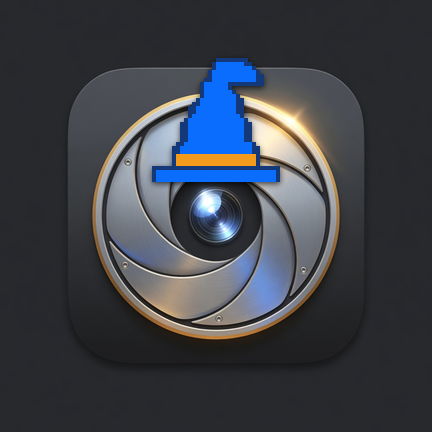

# EndoScope for the DCiS4 / iBorescope4 / iSNAKESCOPE



Borescope app is an unofficial app for the General Tools DCiS4 endo scope also knownas iBorescope4, with the WiFi hotspot called "iSNAKESCOPE" (sometimes written iSnakescope). The old phone app downloads but doesn't connect anymore. 

This page is the install guide for Android and for Omarchy.

The scope is its own Wi-Fi network named `iSNAKESCOPE`. Click the thumbwheel and wait until the green light flashes slowly before you connect.

## Install on Android

The Android app is the Wizwam Borescope APK. It runs on Android 8.1 and newer.

1. On the phone, open the [Wizwam Borescope APK](https://github.com/lukejmorrison/omaborescope/releases/latest/download/wizwam-borescope.apk).
2. Tap the download, then tap Install. If Android asks, allow that browser or the Files app to install unknown apps, then tap Install again.
3. Open **Borescope**. The first time, allow it to join `iSNAKESCOPE`.

The app shows the live picture and can save photos and clips.

## Install on Omarchy

On an Omarchy PC:

```bash
omarchy plugin add https://github.com/lukejmorrison/omaborescope.git --enable --yes
```

A **Scope** button appears on the right side of the bar. Click it for Watch, Photo, Record, Stop, and Disconnect. Esc closes that panel and leaves the live picture up. Stop closes the picture and the recording.

Watch joins the scope on a separate NetworkManager connection named `omaborescope`. That connection does not become the default route. Disconnect drops it and brings back the Wi-Fi you were using.

The **Android** button in the panel opens the APK download above.

From a terminal after the plugin is installed:

```bash
~/.config/omarchy/plugins/lukejmorrison.omaborescope/bin/omaborescope watch
```

The factory Wi-Fi password from the quick start is used automatically. If you changed it on the scope, set `OMABORESCOPE_WIFI_PSK` before launching.

## Remove

```bash
omarchy plugin remove lukejmorrison.omaborescope --yes
```

Photos and clips already saved in `Pictures/OmaBorescope` and `Videos/OmaBorescope` stay where they are. To drop the scope Wi-Fi profile as well:

```bash
nmcli connection delete omaborescope
```

## Dependencies

Omarchy already provides these:

- NetworkManager (`nmcli`), to join the scope when you press Watch
- `curl`, to talk to the camera
- `mpv`, for the live picture
- `ffmpeg`, to record a clip
- `xdg-open`, for the Android download button
- `notify-send`, for the photo notification

## License

[MIT](LICENSE).
